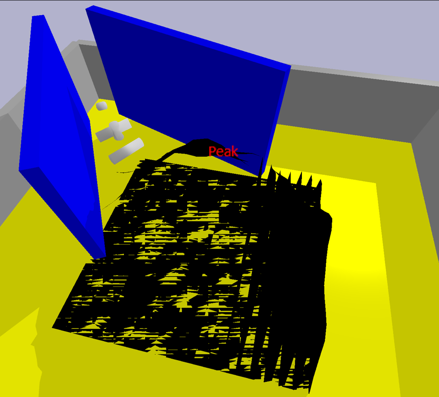
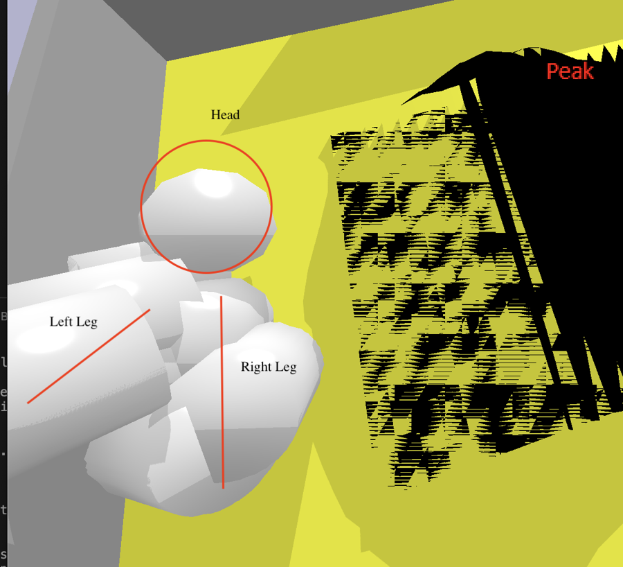
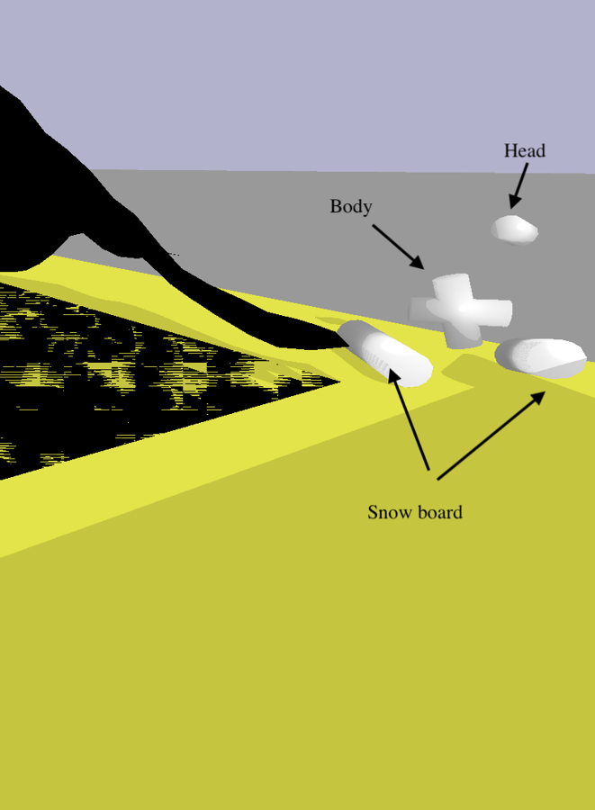

# Hill-Climbing Agent

Evolving virtual creatures with a **genetic algorithm (GA)** to climb a mountain in a PyBullet physics simulation, and learning how quickly evolution finds loopholes in a reward.

The creatures did not reach the peak. What the project did produce is a clear record of **how evolved agents exploit a fitness function**, and how each fix to the reward or the environment opened a new exploit. That is the same problem game designers face when players find unintended strategies.

<p align="center">
  
  
  
</p>

## How it works

Each creature is described by a genome that encodes its body parts, joints and motors. Every generation, the population is simulated for 2,400 physics steps, scored by a fitness function, and bred (roulette-wheel selection, crossover, point / grow / shrink mutation, elitism) to produce the next generation. The best creature of every generation is saved as a CSV so it can be replayed.

## Iterations

**1. Baseline: distance to the peak**

Fitness = (arena diagonal) − (distance from creature to peak). I ran 8 configurations over population size (10 / 20), starting genome length (2 / 3) and mutation rate (0.1 / 1.0), 300 generations each.

- Mutation rate mattered most: at 1.0, mutations erased good traits before selection could keep them.
- Population size and starting genome length had little effect.
- **Exploit found:** creatures grew huge bodies so that one limb touched the peak, or launched themselves into the air, scoring well without climbing.

**2. Improved fitness: penalise size, reward climbing**

Added a body-volume penalty, a reward for net upward movement, and milestone bonuses at 75% and 100% of the mountain's height. I tested 9 combinations of size weight (−0.3 / −0.5 / −0.8) and upward weight (0.3 / 0.5 / 0.8).

- **Exploit found:** creatures evolved pendulum-like limbs that swung in place. Each swing briefly raised their height and collected the upward-movement reward without making progress.

**3. Changing the environment: walls around the spawn zone**

Enclosed the spawn zone so the mountain was the only way out, then tilted the walls and added a third one.

- **Exploit found:** heavily penalised giant creatures still survived because they kept collecting milestone bonuses. Removing the bonuses fixed this, which showed the bonuses, not the penalty weight, were the cause.
- Narrow walls acted as launch ramps; tilting them fixed that. Final populations then split into creatures that were too big or too small to climb.

**4. Motor types**

The starter code had pulse and sine motors. I added **sawtooth** and **noise** motors and compared all four. Pulse gave the strongest push; sine and sawtooth moved more smoothly but with less force; noise was unusable because evolution could not build on random output.

## Takeaways

- **Agents optimise the number, not the intention.** Every reward term I added (size, height gain, milestones) created a new shortcut. Reward design needs to be tested against the cheapest way to score, not just the intended behaviour.
- **Changing the environment can work better than changing the reward.** Walls removed exploits that weight tuning could not.
- **For game AI:** GA is good at producing surprising, varied behaviour (one creature looked like a person mid-stride, another like a skier), but it needs hundreds of generations to converge, which makes it a poor fit for NPCs that must adapt in real time.

## My contribution

This project was built on the PyBullet creature framework provided by the course (genome encoding, creature to URDF conversion, the basic GA loop and simulation). My work on top of it:

- **Fitness functions** in `population.py`: the distance-to-peak baseline and the improved function with size penalty, upward-movement reward and milestone bonuses
- **New creature metrics** in `creature.py`: distance to peak, body volume, maximum height, net upward movement
- **Two new motor types**, sawtooth and noise, in `creature.py`
- **Environments** in `env_objects.py` and the `simulation_*.py` variants: arena, mountain peak detection, enclosing and tilted walls
- **Terrain variants** in `prepare_shapes.py` and `shapes/my_*`: custom Gaussian mountains, including a less steep version
- **Experiment runners** (`test_ga_no_threads_no_walls.py`, `test_ga_no_threads_surrounding_walls.py`) that log fitness, link count and closest distance to the peak
- All parameter experiments and the analysis in the [full report](docs/report.pdf)

## Results data

`elites/` contains the final elite creature from each of the 53 experiment runs. The folder name describes the settings (for example `improved_sizew-0.5_upwardw_0.3`), and several names note what the creature did (`size_too_big`, `try_to_climb_but_cheat`).

## Run it

```bash
pip install -r requirements.txt

# Evolve creatures (walled arena, improved fitness function)
python test_ga_no_threads_surrounding_walls.py

# Watch a saved creature in the GUI
python realtime_from_csv.py elites/surrounding_walls_improved_no_bonus_sizew-0.5_upwardw_0.3_size_OK/elite_299.csv
```

Use `test_ga_no_threads_*.py` on Apple Silicon Macs and Windows, where the multi-threaded version does not run.

## Tech

Python, PyBullet, NumPy, genetic algorithms

## Context

Midterm project (Part B) for the Artificial Intelligence module of my BSc Computer Science (University of London, Goldsmiths).
